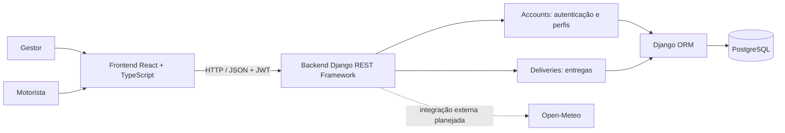

# Arquitetura técnica — Feneme

**Projeto:** Feneme — Gestão de Transporte de Alimentos  
**Repositório:** [moon-byme/feneme-tech](https://github.com/moon-byme/feneme-tech)  
**Jira:** [FT-86 — Documentação da arquitetura técnica](https://feneme.atlassian.net/browse/FT-86)  
**Atualizado em:** 09/11/2026  
**Escopo:** MVP reduzido; visão baseada no código versionado em `main` nesta data.

> A imagem de arquitetura original permanece anexada à issue FT-86 no Jira. Este documento complementa a referência visual com a estrutura e os contratos observados no código.

## 1. Visão geral

O Feneme utiliza uma arquitetura web cliente-servidor. O frontend React/TypeScript apresenta as interfaces dos perfis Gestor e Motorista e consome a API REST. O backend Django/DRF autentica os usuários, aplica permissões e persiste os dados no PostgreSQL por meio do Django ORM.



A integração Open-Meteo está prevista para a Release 2, mas não foi localizada como implementação no código analisado em `main` nesta atualização. O mesmo vale para os recursos de alternativas de trajeto, comparação e recomendação: os arquivos Gherkin existem, mas a presença de cenários não comprova a implementação funcional.

## 2. Frontend

**Tecnologias identificadas:** React 19, TypeScript, Vite e Cypress com Cucumber.

Responsabilidades:
- apresentar login e identificar o perfil autenticado;
- disponibilizar a área de gestão para Gestor;
- disponibilizar a área de entregas atribuídas para Motorista;
- consumir a API pelo módulo `frontend/src/api.ts`;
- manter os tipos compartilhados em `frontend/src/types.ts`;
- executar testes E2E em `frontend/cypress`.

Arquivos de referência:
- `frontend/src/App.tsx`: composição da interface, login e fluxo do Gestor;
- `frontend/src/components/MotoristaHome.tsx`: interface do Motorista;
- `frontend/src/api.ts`: chamadas HTTP;
- `frontend/src/types.ts`: contratos TypeScript;
- `frontend/cypress/e2e/*.feature`: cenários de aceitação em Gherkin.

O token de acesso é enviado no cabeçalho `Authorization: Bearer`. A checagem de token feita na interface serve apenas para controlar a sessão visual; a validação real e as permissões são responsabilidade do backend.

## 3. Backend

**Tecnologias identificadas:** Python, Django 5.2, Django REST Framework, SimpleJWT e django-cors-headers.

Aplicações:
- `accounts`: autenticação, perfil do usuário, permissões e listagem de Motoristas;
- `deliveries`: modelo, serialização, consulta, cadastro e atribuição de entregas;
- `config`: configurações globais, middleware e roteamento Django.

### Perfis e autorização

Os perfis do MVP são:
- `GESTOR`: cadastra e consulta entregas e atribui Motoristas;
- `MOTORISTA`: consulta somente entregas atribuídas a si.

As permissões são aplicadas na API com classes como `IsGestor` e `IsGestorOrMotorista`. A interface não substitui esses controles.

## 4. Persistência

O PostgreSQL é o banco de dados relacional. O Django ORM mapeia os modelos e administra as migrações.

O modelo `Delivery` atualmente contém:
- origem;
- destino;
- descrição da carga;
- Motorista atribuído (opcional);
- Gestor que criou o registro;
- status inicial `PENDENTE`;
- datas de criação e atualização.

A relação com usuários usa a configuração `AUTH_USER_MODEL`. As migrações ficam nas pastas `migrations/` de cada aplicação.

## 5. API REST identificada

| Método | Endpoint | Uso e autorização |
|---|---|---|
| POST | `/api/auth/login/` | Autenticação e emissão de tokens JWT |
| POST | `/api/auth/refresh/` | Renovação do token |
| GET | `/api/drivers/` | Lista Motoristas ativos; somente Gestor |
| GET | `/api/deliveries/` | Lista entregas visíveis ao perfil autenticado |
| POST | `/api/deliveries/` | Cadastra entrega; somente Gestor |
| GET | `/api/deliveries/{id}/` | Consulta detalhe conforme permissão |
| POST | `/api/deliveries/{id}/assign-driver/` | Atribui Motorista; somente Gestor |

Os contratos podem ser conferidos em `backend/config/urls.py`, `backend/deliveries/urls.py`, `backend/accounts/views.py` e `backend/deliveries/views.py`.

## 6. Integração externa — Open-Meteo

A Open-Meteo é a fonte externa prevista para previsão de temperatura ambiente. A integração deve ser opcional para as operações manuais: timeout, erro HTTP ou resposta sem os dados necessários não podem bloquear cadastro nem comparação manual de trajetos.

Diretrizes para a implementação:
- manter a chamada externa isolada em um cliente/serviço específico;
- definir timeout explícito;
- tratar indisponibilidade, erros HTTP e payload incompleto;
- apresentar aviso de previsão indisponível;
- não confirmar recomendação climática sem dados válidos;
- testar falhas com mocks, sem depender da disponibilidade real do provedor.

**Estado na atualização:** integração não localizada no código da branch `main` consultada. Não considerar este componente entregue apenas por estar previsto na arquitetura ou descrito em histórias.

## 7. Segurança e configuração

- autenticação JWT com tokens de acesso e refresh;
- endpoints protegidos por padrão com `IsAuthenticated`;
- permissões por perfil também no backend;
- variáveis de ambiente para segredo, modo DEBUG, hosts, CORS e conexão PostgreSQL;
- credenciais de teste fictícias para automação.

Antes de publicar em produção, configurar segredo forte, `DEBUG=False`, hosts e origens CORS restritos. Não registrar senhas, tokens ou dados privados em logs.

## 8. Testes e integração contínua

Backend:
```bash
cd backend
python manage.py check
python manage.py test
```

Frontend:
```bash
cd frontend
npm ci
npm run build
npm run e2e
npm run e2e:smoke
```

O workflow `.github/workflows/ci.yml` executa verificações do Django, build do frontend e cenários E2E `@smoke`. A regressão completa de R1 está sendo acrescentada no PR #15 e só passa a fazer parte da branch principal após seu merge.

## 9. Limites do escopo documentado

Esta arquitetura descreve o que foi encontrado no repositório na data indicada. Ela não afirma que os recursos abaixo já estejam implementados:
- cadastro e comparação de alternativas de trajeto;
- consulta de previsão Open-Meteo;
- recomendação de trajeto;
- atualização e histórico persistente de status.

Esses itens fazem parte do planejamento funcional da Release 2 e precisam ser confirmados por código, testes e evidências de CI antes de serem registrados como concluídos.

## 10. Referências

- [Repositório](https://github.com/moon-byme/feneme-tech)
- [Jira FT-86](https://feneme.atlassian.net/browse/FT-86)
- [Django](https://docs.djangoproject.com/)
- [Django REST Framework](https://www.django-rest-framework.org/)
- [SimpleJWT](https://django-rest-framework-simplejwt.readthedocs.io/)
- [React](https://react.dev/)
- [Open-Meteo](https://open-meteo.com/)
