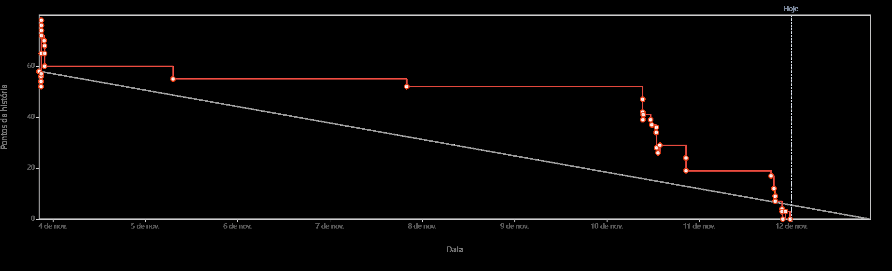
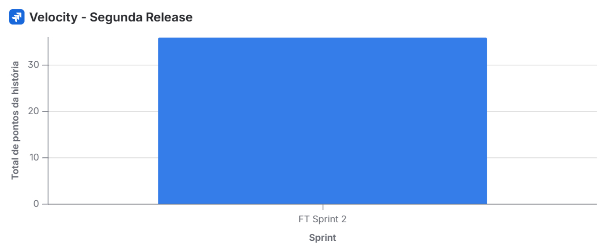

# Métricas e impedimentos — Sprint 2

**Projeto:** Feneme  
**Sprint:** FT Sprint 2 | **Período:** 03/11/2026 a 12/11/2026 | **Release:** R2  
**Responsável pelo acompanhamento:** Scrum Master  
**Fontes:** Jira (quadro, histórico das issues e relatório nativo de Burndown), painel de Velocity do projeto e registros de testes, Pull Requests e CI no GitHub.  
**Situação deste registro:** indicadores do quadro conferidos em 12/11/2026; validação formal dos aceites, da DoD e das decisões da Sprint Review ainda não documentada neste relatório.

## 1. Burndown da Sprint 2

*Fonte: Jira — “Gráfico de burndown do sprint”, FT Sprint 2, campo “Pontos da história”; imagem obtida em 12/11/2026.*

O gráfico apresenta a evolução dos Story Points restantes (linha vermelha) em comparação com a trajetória ideal (linha cinza). O trabalho registrado no Jira caiu principalmente nos últimos dias da sprint. Na captura de 12/11, a linha vermelha atinge **0 SP restantes**, de acordo com os status e as movimentações registrados no quadro naquele momento.

**Interpretação:** a queda no Burndown não representa, por si só, validação da Definition of Done (DoD): também podem afetar a curva alterações de escopo, estimativas e mudanças de status. A diferença entre o início da linha do relatório nativo e a reconstrução abaixo deve ser conferida no histórico de eventos do gráfico, sem presumir sua causa.

### Alterações de escopo identificadas no histórico das issues

| Evento | Data | SP | Observação |
|---|---|---:|---|
| Conjunto de 11 issues inicialmente selecionadas | 03/11 | 40 | Soma das estimativas na reconstrução das issues; **não é o valor inicial validado do gráfico nativo** |
| Entrada da FT-58 (US-10) | 10/11, 09h28 | +2 | Antecipada da Sprint 3 |
| Entrada da FT-56 (US-07) | 10/11, 12h53 | +2 | Antecipada da Sprint 3 |
| Saída da FT-32 | 11/11, 19h26 | −5 | Transferida para a Sprint 3, não concluída na Sprint 2 |
| Saída da FT-33 | 11/11, 21h45 | −3 | Transferida para a Sprint 3, não concluída na Sprint 2 |
| **Escopo nas 11 issues remanescentes** | **12/11, consulta ao Jira** | **36** | **11 issues, todas com status Concluído** |

A reconstrução de escopo resulta em **40 + 2 + 2 − 5 − 3 = 36 SP**. O gráfico oficial de Burndown apresenta uma linha inicial superior a essa reconstrução; portanto, **não se deve tratar os 40 SP como valor inicial confirmado pelo relatório nativo**. Para reconciliar completamente os números, é necessário conferir os eventos exibidos pelo Jira, sobretudo alterações de estimativas e escopo ocorridas durante o início da sprint.

## 2. Velocity da Sprint 2

*Fonte: Jira — widget “Velocity - Segunda Release”, FT Sprint 2, imagem obtida em 12/11/2026.*

O widget apresenta **36 Story Points** para a FT Sprint 2. A consulta ao quadro confirma que as **11 issues remanescentes somam 36 SP e estão marcadas como Concluídas**. Essa é a **velocity indicada pelo painel do Jira (por status)**, mas não deve ser confundida automaticamente com a *velocity homologada segundo a DoD*.

| Indicador | Valor | Situação |
|---|---:|---|
| Escopo remanescente após as movimentações | 36 SP | Conferido nas 11 issues da Sprint 2 |
| Pontos em status Concluído | 36 SP | Conferido no quadro do Jira |
| Pontos restantes por status na captura | 0 SP | Exibido no Burndown oficial |
| Histórias funcionais com aceite registrado do PO | 12 SP | FT-46 (3), FT-47 (5), FT-56 (2) e FT-58 (2) |
| Desses pontos funcionais, com ressalva de aceite | 2 SP | FT-58: PR #5 não teve aprovação prévia formal |
| **Velocity formal validada pela DoD na Review** | **Pendente** | Requer decisão do PO e conferência da DoD |

### Composição dos 36 SP no quadro

| Issue | SP | Evidência ou ressalva principal |
|---|---:|---|
| [FT-36](https://feneme.atlassian.net/browse/FT-36) — driver | 3 | Relacionada à usabilidade/Q-07; tempos sem cronometragem |
| [FT-46](https://feneme.atlassian.net/browse/FT-46) — US-06 | 3 | Aceite do PO; [PR #20](https://github.com/moon-byme/feneme-tech/pull/20) |
| [FT-47](https://feneme.atlassian.net/browse/FT-47) — US-08 | 5 | Aceite do PO após demonstração real; [PR #23](https://github.com/moon-byme/feneme-tech/pull/23) |
| [FT-56](https://feneme.atlassian.net/browse/FT-56) — US-07 | 2 | Aceite do PO; [PR #25](https://github.com/moon-byme/feneme-tech/pull/25) |
| [FT-58](https://feneme.atlassian.net/browse/FT-58) — US-10 | 2 | Aceita **com ressalva**; [PR #5](https://github.com/moon-byme/feneme-tech/pull/5) sem revisão formal anterior |
| [FT-62](https://feneme.atlassian.net/browse/FT-62) — risco R03 | 2 | Ações relativas a mensagens/logs e Q-06 |
| [FT-74](https://feneme.atlassian.net/browse/FT-74) — Q-06 | 2 | 20/20 verificações de controle de acesso; 0 exposição relatada |
| [FT-75](https://feneme.atlassian.net/browse/FT-75) — Q-07 | 1 | Resultado 5/5 aceito pelo PO; tempos não medidos com cronômetro |
| [FT-87](https://feneme.atlassian.net/browse/FT-87) — Scrum Master | 3 | **Concluída no Jira**, mas quatro itens da DoD seguem desmarcados |
| [FT-88](https://feneme.atlassian.net/browse/FT-88) — QA | 5 | Concluída no Jira, com itens de DoD sobre cenários e correção ainda desmarcados |
| [FT-89](https://feneme.atlassian.net/browse/FT-89) — PO/DevOps | 8 | Concluída no Jira, mas a DoD ainda pede decisões pós-Review e revisão do Plano de Releases |
| **Total** | **36** | **Total operacional, sujeito à validação formal da DoD** |

**Critério para fechamento:** confirmar na Review quais itens serão contabilizados na velocity, os aceites e as ressalvas. Preservar, em paralelo, o indicador funcional de **12 SP aceitos pelo PO**, dos quais **2 SP com ressalva**. Não converter o status Concluído em evidência automática de atendimento à DoD.

## 3. Impedimentos e não conformidades acompanhados

| Registro | Situação observada | Encaminhamento |
|---|---|---|
| **Medição de usabilidade Q-07** | Cinco participantes tiveram resultados registrados, mas os tempos não foram cronometrados. | Manter a limitação metodológica explícita; repetir a medição com cronômetro se a equipe ou a professora exigir. |
| **Sprint Goal e escopo executado** | O objetivo cita atualização de status das entregas; a FT-48/US-11 está planejada para a Sprint 3. | Registrar a divergência e a decisão do PO na Review. |

## 4. Acompanhamento dos riscos R01 a R09

A [FT-8 — Análise de Riscos](https://feneme.atlassian.net/browse/FT-8) e a planilha de riscos são as fontes oficiais detalhadas; este quadro resume apenas o acompanhamento conhecido, sem substituir a revisão da equipe.

| Risco | Registro de acompanhamento | Situação de revisão |
|---|---|---|
| R01 — Acesso cruzado | Cenários de bloqueio relatados como aprovados; residual a confirmar | Conferência final pendente |
| R02 — Credenciais inválidas | Residual 15 → 10 registrado | Conferir/ratificar na revisão |
| R03 — Mensagens de erro e logs | Residual 12 → 8 registrado; relação com Q-06 e FT-62 | Conferir/ratificar na revisão |
| R04 — Recomendação climática incorreta | Tratamento depende da recomendação de rotas | Acompanhar na Sprint 3 |
| R05 — Persistência de status e histórico | Dependente da FT-48/US-11 | Acompanhar na Sprint 3 |
| R06 — Falha da Open-Meteo bloquear fluxo manual | Residual 16 → 8 registrado; testes de falha simulada | Reavaliar quando a recomendação estiver integrada |
| R07 — Justificativa da recomendação | Dependente da funcionalidade de recomendação | Acompanhar na Sprint 3 |
| R08 — Passos excessivos no cadastro | Q-07 tem limitação de cronometragem | Reavaliar após evidência de usabilidade |
| R09 — Visualização móvel de status | Tratamento planejado para Sprint 4 | Sem fechamento nesta Sprint 2 |

**Nota:** avaliações residuais registradas não equivalem a comprovação de que todos os nove riscos foram encerrados. Preservar os valores-base e registrar decisões da equipe/PO na planilha de riscos.

## 5. Análise e encaminhamentos para o fechamento

O progresso exibido no Burndown concentrou-se nos últimos dias, enquanto os dois gráficos do Jira indicam **0 SP restantes** e **36 SP em status Concluído** na captura de 12/11. O indicador de desempenho por status é positivo, mas a avaliação da sprint deve distinguir o andamento do quadro da aceitação efetiva, considerando DoD, ressalvas, alterações de escopo e alinhamento ao objetivo planejado.

**Itens que dependem de confirmação documental após a Review/Retrospectiva:**

- [ ] Confirmar data, horário, participantes e decisões reais da Review e da Retrospectiva; vincular as atas, se realizadas.
- [ ] Registrar o aceite final do PO por história e a convenção de contagem da velocity; manter as ressalvas de FT-58, FT-87, FT-88 e FT-89.
- [ ] Conferir os eventos do Burndown oficial e explicar a diferença entre sua abertura e a reconstrução de 40 SP.
- [ ] Atualizar o estado final do I-03 com evidências e responsáveis.
- [ ] Validar com a equipe o acompanhamento R01–R09 e os resultados Q-06, Q-07 e Q-13 (este último baseado em falhas simuladas).
- [ ] Publicar este documento com as duas imagens por Pull Request revisado e vincular o PR à [FT-87](https://feneme.atlassian.net/browse/FT-87).

**Continuidade na Sprint 3:** [FT-90 (Scrum Master)](https://feneme.atlassian.net/browse/FT-90), [FT-91 (QA)](https://feneme.atlassian.net/browse/FT-91) e [FT-92 (PO/DevOps)](https://feneme.atlassian.net/browse/FT-92), conforme o escopo definido nas issues.

## 6. Referências

- [FT-87 — Acompanhamento de Scrum Master](https://feneme.atlassian.net/browse/FT-87)
- [FT-88 — Evidências de QA](https://feneme.atlassian.net/browse/FT-88)
- [FT-89 — Registros de PO/DevOps](https://feneme.atlassian.net/browse/FT-89)
- [FT-8 — Plano de Riscos](https://feneme.atlassian.net/browse/FT-8)
- [FT-9 — Plano de Qualidade](https://feneme.atlassian.net/browse/FT-9)
- [PR #14 — Planning, calendário e acordos da Sprint 2](https://github.com/moon-byme/feneme-tech/pull/14)
- [PR #18 — CT-22 e CT-23](https://github.com/moon-byme/feneme-tech/pull/18)
- [PR #24 — Testes simulados de falha na Open-Meteo](https://github.com/moon-byme/feneme-tech/pull/24)
- [PR #33 — Registro de usabilidade Q-07](https://github.com/moon-byme/feneme-tech/pull/33)
