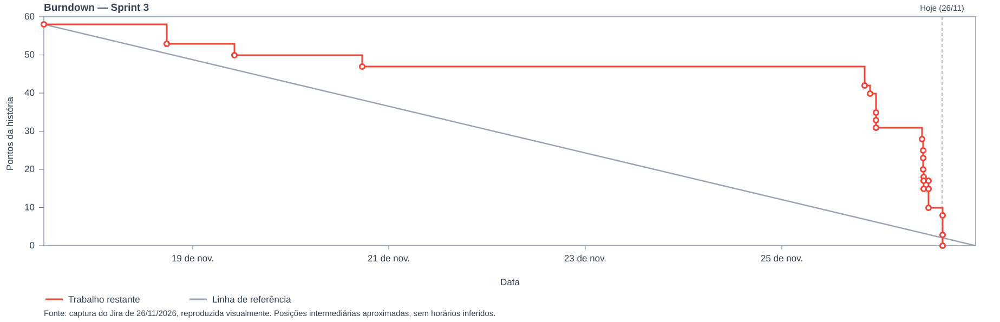
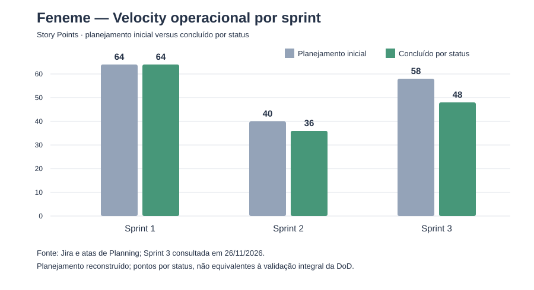

# Métricas e impedimentos — Sprint 3 / R2

**Recorte:** conferência documental de 26/11/2026, antes do fechamento formal da Sprint 3. Não é ata de Review/Retrospectiva nem cálculo definitivo de velocity. Fonte: Jira, [Planning 3](feneme_sprint_planning_3.typ), GitHub Actions e PRs.

## 1. Escopo e fotografia do board

Na Planning de 17/11, 19 issues/58 SP foram ratificados conforme [FT-90](https://feneme.atlassian.net/browse/FT-90?focusedCommentId=10217). Na consulta de 26/11 anterior à correção da FT-115, a Sprint 3 tinha 16 issues/50 SP:

| Situação | Issues | SP |
| --- | --- | ---: |
| Concluído por status | FT-115, FT-114, FT-113, FT-112, FT-110, FT-81, FT-80, FT-65, FT-64, FT-59, FT-49, FT-48 | 35 |
| Em andamento | FT-92, FT-91, FT-90 | 10 |
| Em análise | FT-34 | 5 |
| Total | 16 | 50 |

FT-115 (2 SP) foi corrigida para Sprint 4/R3 e Em andamento conforme decisão do PO de 25/11: não integra a entrega aceita da R2. Após essa correção, mantidos os demais estados, o escopo fica em 15 issues/48 SP, sendo 33 SP em Done por status. Na fotografia inicial, a FT-114 ainda exigia validação manual de QA; posteriormente confirmada no comentário 10325. As cinco US funcionais da S3 somam 19 SP e possuem evidências e decisão de aceite do PO, sujeitas à ratificação da Review; não confundir esse subtotal com velocity aceita.

Após a conferência QA/PO já registrada na FT-80, o driver FT-34 (5 SP) foi atualizado para Concluído. Mantidos os demais estados, a fotografia subsequente é de 12 issues/38 SP em Done e 3 issues/10 SP em andamento, dentro de 15 issues/48 SP. Não equivale à velocity final.

A diferença entre 58 SP da Planning e a fotografia de 48 SP corresponde à alteração líquida de escopo (-10 SP); a trajetória diária e cada mudança devem ser confirmadas no relatório do Jira, sem inventar pontos de burndown. Ao término, registrar a velocity apenas com itens que cumpram a DoD acordada, discriminando as ressalvas e carryovers.

## 2. Impedimentos e qualidade

- I-03: acompanhamento preventivo do fluxo de PR. [FT-72](https://feneme.atlassian.net/browse/FT-72?focusedCommentId=10319): 19/19 PRs #39–#57 aprovadas por outro integrante antes do merge, 18/18 no recorte estrito de main. A #42 foi integrada na feature e chegou à main pela #43; conferir base antes de integrar PRs dependentes.
- Q-15: [FT-83](https://feneme.atlassian.net/browse/FT-83?focusedCommentId=10320): 5/5 US da S3 com vínculo teste/PR/Jira; não implica, isoladamente, cumprimento da DoD. FT-114 validada manualmente pelo QA (10325).
- Regressão integral @R2: [29/29](https://github.com/moon-byme/feneme-tech/actions/runs/45731598047), PR #51 integrada. FT-57 fora da R2; manter o escopo aprovado.
- Homologação: falhas #345 e #348 corrigidas pela PR #53; [#351](https://github.com/moon-byme/feneme-tech/actions/runs/45738722270) confirmou recuperação; [#375](https://github.com/moon-byme/feneme-tech/actions/runs/45832088850) verde inclusive deploy. Consultar [relatório de pipeline](../../releases/release-2/relatorio-pipeline.md).
- QA: validação manual do catálogo e fontes FT-114 confirmada pelo QA no comentário 10325; relatório final FT-91 permanece a conferir.
- Riscos: [riscos residuais R2](../../releases/release-2/riscos-residuais.md), FT-8. R05/R06 com residual 8 documentado; R08 e R10 seguem em tratamento, R01 residual 10 regularizado em 26/11 (FT-60/10327, FT-124/10332). Revisão final R01–R10 delegada a Neto e João Paulo. O registro de riscos deve manter decisões e evidências reais.

## 3. Fechamento a registrar

- [x] Burndown oficial parcial de 26/11 analisado e linkado (seção 4).
- [x] Gráfico comparativo de velocity operacional e análise elaborados com dados do Jira; integração da PR #60 pendente. Conferência do gráfico nativo após encerramento, se disponível, é complementar.
- [x] Review realizada e ata publicada pela PR #59; ver [ata da Review](ata-review.md).
- [x] Retrospectiva realizada e ata publicada pela PR #59; ver [ata R2](../../releases/release-2/ata-retrospectiva-release-2-feneme.md). Revisão de riscos pendente separadamente.
- [ ] Revisão final do registro de riscos e links da DoD; publicação formal da versão pelo PO/DevOps.

**Acompanhamento:** [FT-90](https://feneme.atlassian.net/browse/FT-90) · [FT-91](https://feneme.atlassian.net/browse/FT-91) · [FT-92](https://feneme.atlassian.net/browse/FT-92).

## 4. Burndown oficial — captura de 26/11/2026

**Fonte:** [Burndown Chart do Jira — board 1](https://feneme.atlassian.net/jira/software/projects/FT/boards/1/reports/burndown?source=overview&atlOrigin=eyJpIjoiMTE3NzJjOTJhZTAxNGMwNThlN2U0MDViZTU4OGMzMjkiLCJwIjoiaiJ9), selecionando FT Sprint 3; captura fornecida pela SM em 26/11. A sprint ainda estava ativa na captura.

A linha de trabalho restante inicia em 58 SP, reduz aproximadamente para 53, 50 e 47 SP entre 18 e 20/11, permanece em aproximadamente 47 SP até 25/11 e apresenta reduções concentradas nos dias 25 e 26/11. Há também pequenas oscilações na fase final. O último ponto visível é de 10 SP restantes. As leituras intermediárias são aproximadas, não timestamps ou eventos exportados. A linha ideal é referência de redução linear, não obrigação de baixa diária. A redução acumulada de 48 SP desde o início não corresponde a 48 SP entregues, pois inclui mudanças de escopo.

| Indicador | Resultado na consulta de 26/11 |
| --- | ---: |
| Compromisso inicial (Planning) | 19 issues / 58 SP |
| Alteração líquida de escopo | -10 SP |
| Escopo atual | 15 issues / 48 SP |
| Concluído por status | 12 issues / 38 SP (79,2% do escopo atual) |
| Restante | 3 issues / 10 SP (FT-90: 2; FT-91: 3; FT-92: 5) |
| Subtotal funcional | 5 US / 19 SP |

**Análise:** o progresso registrado concentrou-se nos últimos dias, indicando necessidade de atualizar o quadro continuamente, verificar dependências e distribuir entregas e documentação ao longo da sprint. A ação de acompanhamento comparativo está na [FT-126](https://feneme.atlassian.net/browse/FT-126). Não atribuir todas as quedas a conclusões de issues sem a tabela de eventos do relatório. A consulta JQL da Sprint 3 confirma os 10 SP pendentes. A captura original deve ser preservada como evidência complementar; o link do Jira é a fonte consultável.

### Velocity — fotografia provisória, não resultado definitivo

| Sprint | SP concluídos por status | Situação |
| --- | ---: | --- |
| S1 | 64 | Encerrada; ressalva de DoD histórica |
| S2 | 36 | Encerrada; recorte operacional |
| S3 | 38 | Ativa na captura; 10 SP ainda em andamento |

O Velocity Chart apresenta sprints encerradas ([documentação Atlassian](https://support.atlassian.com/jira-software-cloud/docs/view-and-understand-the-velocity-chart/)). O compromisso é medido na abertura, e o concluído no fechamento, conforme mapeamento de colunas. O gráfico alternativo compara o escopo final e os pontos concluídos por status; o gráfico nativo, quando disponível após encerramento, poderá complementar a análise do compromisso original. O Sprint Report separado não é exigência da disciplina. Não encerrar a sprint somente para gerar o gráfico nem mover itens para Done sem evidências. Registrar diferenças entre pontos concluídos por status e pontos efetivamente aceitos.

### Atualização de 26/11 — segunda captura do Burndown

*Figura: reprodução visual da segunda captura fornecida pela SM, com posições intermediárias aproximadas. O PNG original não foi anexado pelo conector; a fonte oficial é o [gráfico do Jira](https://feneme.atlassian.net/jira/software/projects/FT/boards/1/reports/burndown?source=overview), selecionando FT Sprint 3.*

A segunda captura oficial enviada pela SM mostra 0 SP restantes, após a conclusão por status das FT-90 (2 SP), FT-91 (3 SP) e FT-92 (5 SP). A nova consulta JQL `project = FT AND sprint = 'FT Sprint 3'` retornou 15/15 issues em Concluído, totalizando 48/48 SP no escopo atual. Preserva-se a fotografia anterior de 38/48 SP como histórico, não como estado atual. As três issues de encerramento ainda apresentam itens de DoD não marcados nas descrições; a revisão de riscos e a confirmação das evidências de encerramento permanecem independentes da contagem por status.

| Sprint | Escopo final (SP) | Concluído por status (SP) | Conclusão do escopo final |
| --- | ---: | ---: | ---: |
| S1 | 64 | 64 | 100% |
| S2 | 36 | 36 | 100% |
| S3 | 48 | 48 | 100% |

S3: 48/48 SP do escopo atualizado (100%), sem pontos restantes no quadro; crescimento de 33,3% sobre os 36 SP da S2. Para comparar a execução do escopo efetivamente mantido, o gráfico usa a mesma base de escopo final para as três sprints. O compromisso inicial e as alterações de escopo permanecem no histórico, não sendo confundidos com trabalho pendente. O gráfico não reproduz o indicador nativo de compromisso inicial do Jira. A SM informou que o menu disponibiliza Burndown, Burnup e Velocity, mas não um Sprint Report separado; a consulta das issues é a fonte alternativa da fotografia. O gráfico comparativo é elaborado a partir dos dados registrados, não exportação do Velocity Chart nativo. Confirmar o gráfico nativo após encerramento da sprint, se disponível; não declarar cumprimento de DoD apenas pelo status. 

### Histórico do replanejamento da S3

A consulta aos históricos das issues confirmou as quatro transferências do escopo inicial de 58 SP para a R3:

| Issue | SP | Alteração no Jira | Destino | Motivo |
| --- | ---: | --- | --- | --- |
| [FT-32](https://feneme.atlassian.net/browse/FT-32) | 5 | 25/11, 23h13 | S5 | Verificação restante depende da recomendação climática FT-57; continuidade dos fluxos manuais já comprovada. |
| [FT-67](https://feneme.atlassian.net/browse/FT-67) | 2 | 26/11, 10h48 | S4 | Tratamento complementar de usabilidade junto à FT-117. |
| [FT-116](https://feneme.atlassian.net/browse/FT-116) | 1 | 26/11, 10h48 | S4 | Tratamento de cota/custo e falhas das APIs Google, dependente da FT-115. |
| [FT-115](https://feneme.atlassian.net/browse/FT-115) | 2 | 26/11, 12h01 | S4 | Evidências restantes de configuração do Google Cloud, pré-requisito de FT-118. |
| Total | 10 | | | |

A alteração de escopo é rastreável; não há itens restantes no escopo final da S3 por status. A revisão dos riscos e as verificações de DoD ainda não comprovadas permanecem distintas desta métrica.
